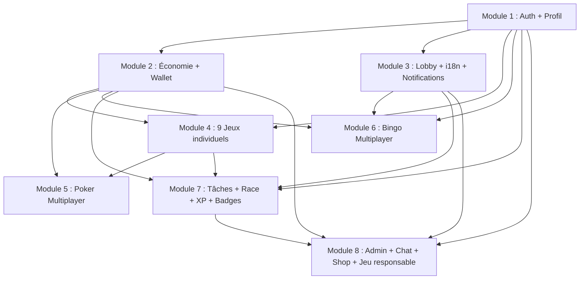

# Plan de réalisation

> Références : [02-requirements.md](./02-requirements.md), [03-design-proto.md](./03-design-proto.md), [04-architecture.md](./04-architecture.md)

---

## Ordre d'implémentation

### Module 1 : Socle technique + Authentification + Profil de base

**Dépendances** : aucune

**User stories** : US-001, US-002, US-003, US-004, US-005, US-006, US-007, US-149, US-150 (export)
- NF-005 (JWT), NF-006 (bcrypt), NF-007 (rate limiting login), NF-018 (HTTPS)
- RM-001 (âge min 18+), RM-006 (welcome bonus flag)
- CR-003 (GDPR consent), CR-006 (CGU)

**Frontend** :
- Pages : `Login.tsx` (#login), `Register.tsx` (#register), `ForgotPassword.tsx`, `ResetPassword.tsx`
- Composants : `authStore` (Zustand), `api.ts` (Axios + intercepteurs refresh token), hooks `useAuth`
- Auth context, ProtectedRoute, GuestRoute guards
- Bannière de consentement cookies (CR-005)

**Backend domain** :
- Ports : `AuthRepository`, `AuthService`, `TokenService`, `SessionService`, `OAuthService`, `UserRepository`
- Services : `RegisterUser`, `AuthenticateUser`, `RefreshToken`, `ResetPassword`, `Verify2FA`, `DeleteAccount`, `UpdateProfile`
- Entités : `User` (credentials, status, role, totp_secret), `Session` (token, refresh, expires), `OAuthProfile`

**Backend infrastructure** :
- `PostgresAuthRepository`, `PostgresUserRepository` (Prisma)
- `PassportAuthAdapter`, `JwtTokenAdapter`, `GoogleOAuthAdapter`
- `RedisSessionAdapter` (sessions, refresh tokens)
- `PrismaClient`, migration initiale `users` table

**API REST** :
| Méthode | Path | Description |
|---------|------|-------------|
| POST | `/api/v1/auth/register` | Inscription email + mot de passe |
| POST | `/api/v1/auth/login` | Connexion |
| POST | `/api/v1/auth/google` | Google OAuth2 |
| POST | `/api/v1/auth/refresh` | Rafraîchir JWT |
| POST | `/api/v1/auth/logout` | Déconnexion |
| POST | `/api/v1/auth/forgot-password` | Demande réinit |
| POST | `/api/v1/auth/reset-password` | Réinit avec token |
| POST | `/api/v1/auth/2fa/enable` | Activer 2FA |
| POST | `/api/v1/auth/2fa/verify` | Vérifier 2FA |
| DELETE | `/api/v1/auth/account` | Supprimer compte |
| GET | `/api/v1/auth/sessions` | Sessions actives |
| DELETE | `/api/v1/auth/sessions/:id` | Déconnecter session |
| GET | `/api/v1/users/me` | Obtenir profil |
| PUT | `/api/v1/users/me` | Màj profil |
| PUT | `/api/v1/users/me/avatar` | Changer avatar |
| GET | `/api/v1/users/me/export` | Export GDPR |

**Infrastructure partagée (tous les modules)** :
- Docker Compose : `postgres:16-alpine`, `redis:7-alpine`, backend, frontend
- Middleware : `auth.middleware.ts`, `validation.middleware.ts`, `rate-limit.middleware.ts`
- Zod schemas pour validation
- Socket.io server bootstrap avec Redis adapter
- Prisma schema avec table `users`

**Complexité** : Élevée (auth, OAuth, JWT, sécurité, mise en place infrastructure)

---

### Module 2 : Base économique + Wallet + Daily Rewards

**Dépendances** : Module 1

**User stories** : US-008, US-009, US-010, US-011, US-013, US-014
- RM-005 (jetons quotidiens depuis House), RM-006 (bonus bienvenue), RM-011 (capital 50M), RM-015 (recharge House), RM-008 (atomicité transactions)

**Frontend** :
- Composants : `BalanceDisplay` (solde en temps réel via socket `user:balance`), `DailyRewardWidget` (streak visuel, animation de claim)
- Pages : transaction history (intégrée au profil ou page dédiée)
- Store : `balanceStore` (Zustand), mise à jour temps réel via Socket.io
- Notification toast quand daily reward disponible

**Backend domain** :
- Ports : `WalletRepository`, `TransactionRepository`, `HouseAccountRepository`, `BonusService`, `DailyRewardRepository`, `StreakService`
- Services : `CreditBalance`, `DebitBalance`, `GetBalance`, `GetHistory`, `ClaimDailyReward`, `CalculateStreakBonus`, `ResetStreak`, `GetHouseAccount`, `CalculateProfitability`
- Entités : `Wallet` (balance, locked_balance), `Transaction` (amount, type, reference, status, balance_before, balance_after), `HouseAccount` (capital, total_bets, total_wins, total_bonus), `DailyReward` (streak, last_claim, amount)

**Backend infra** :
- `PostgresWalletRepository` (Prisma), `PostgresTransactionRepository`, `PostgresHouseAccountRepository`
- `PostgresDailyRewardRepository`, `CacheStreakAdapter` (Redis)
- Prisma migrations : `transactions`, `daily_rewards`

**API REST** :
| Méthode | Path | Description |
|---------|------|-------------|
| GET | `/api/v1/economy/balance` | Solde actuel |
| GET | `/api/v1/economy/history` | Historique filtré |
| POST | `/api/v1/economy/daily-reward/claim` | Réclamer daily reward |
| GET | `/api/v1/economy/daily-reward/status` | État du streak |
| GET | `/api/v1/users/me/transactions` | Historique transactions |

**Événements Socket.io** : `user:balance` (mise à jour solde), `notification` (daily reward dispo)

**Complexité** : Moyenne

---

### Module 3 : Lobby + Navigation + Internationalisation + Notifications

**Dépendances** : Module 1

**User stories** : US-DASH-001, US-DASH-002, US-DASH-003, US-141, US-142, US-143, US-144
- Notifications : US-127 (daily reward dispo), US-128 (gros gain ≥50x), US-129 (défi complété), US-130 (waitlist poker)
- NF-016 (100% textes externalisés), NF-017 (Socket.io clés i18n)

**Frontend** :
- Pages : `Lobby.tsx` (#lobby) — grille 13 jeux, solde header, notifications
- Composants layout : `Header` (solde, notifications, sélecteur langue, avatar), `Footer`, `PageContainer`
- Composants : `LanguageSelector` (FR/EN), `NotificationBell`, `StreakBadge`, `QuickStats`
- i18n : `i18n/fr.json`, `i18n/en.json`, config i18next (détection navigateur + fallback)
- Store : `uiStore` (sidebar, modals), `notificationStore`
- Hooks : `useI18n`, `useNotification`, `useSocket`

**Backend domain** :
- Ports : `NotificationRepository`, `NotificationSender`, `NotificationTemplate`, `TranslationProvider`, `LanguageDetector`
- Services : `SendNotification`, `MarkAsRead`, `GetUnread`, `ClearAll`, `ServerTranslate`
- Entités : `Notification` (type, title_key, data, read)

**Backend infra** :
- `PostgresNotificationRepository`, `SocketNotificationSender`, `I18nNotificationTemplate`
- `JsonFileTranslationAdapter`, `BrowserLanguageDetector`
- Prisma migration : `notifications`

**API REST** :
| Méthode | Path | Description |
|---------|------|-------------|
| GET | `/api/v1/games` | Liste des jeux (config) |
| GET | `/api/v1/i18n/{lang}` | Traductions serveur |
| GET | `/api/v1/notifications` | Liste notifications |
| POST | `/api/v1/notifications/:id/read` | Marquer lue |
| POST | `/api/v1/notifications/read-all` | Tout marquer lu |

**Événements Socket.io** : `notification`, `notification:badge`, `lobby:stats`

**Mocks pour dépendances futures** : les notifications de jeu (gros gain, défi) utiliseront un système d'événements interne pub/sub ; tant que les jeux ne sont pas implémentés, ces notifications sont mockées.

**Complexité** : Faible (i18n + UI layout)

---

### Module 4 : Jeux individuels (Slots, Blackjack, Roulette, Crash, Plinko, Mines, Wheel, Limbo, Craps)

**Dépendances** : Module 1 (auth), Module 2 (économie/wallet)

**User stories** :
- Slots 3 rlx : US-015, US-016, US-017, US-018, US-019, US-020, US-021
- Slots 4 rlx : US-022, US-023, US-024, US-025, US-026, US-027
- Slots 5 rlx : US-028, US-029, US-030, US-031, US-032, US-033
- Blackjack : US-034, US-035, US-036, US-037, US-038, US-039, US-040, US-041, US-042
- Roulette : US-043, US-044, US-045, US-046, US-047, US-048, US-049
- Crash : US-088, US-089, US-090, US-091, US-092, US-093, US-094
- Plinko : US-095, US-096, US-097, US-098, US-099, US-100, US-101
- Mines : US-081, US-082, US-083, US-084, US-085, US-086, US-087
- Wheel : US-102, US-103, US-104, US-105, US-106, US-107
- Limbo : US-108, US-109, US-110, US-111, US-112, US-113
- Craps : US-067, US-068, US-069, US-070, US-071, US-072, US-073
- NF-009 (serveur-authoritative), RM-007 (RNG CSPRNG), RM-009 (résultat serveur), RM-013 (mise min 10), RM-004 (house edge configurable)

**Frontend** :
- Page générique `GamePage.tsx` avec routing par type de jeu
- Composants par jeu (cf. design proto #4 à #15) :
  - `Slots3/4/5` : Reel, Payline, Paytable, AutoSpin
  - `Blackjack` : Table, Card, Hand, ChipSelector, ActionButtons (Hit/Stand/Double/Split/Surrender/Insurance)
  - `Roulette` : Wheel canvas, BetGrid (numéros + mises combinées), ChipPlacer, HistoryNumbers
  - `Crash` : CrashGraph (canvas/WebGL), BetPanel, CashOutButton, HistoryChart
  - `Plinko` : PlinkoBoard (canvas physique), Ball, MultiplierGrid, RiskSelector
  - `Mines` : MinesGrid 5x5, Cell, MultiplierDisplay, CashOutButton
  - `Wheel` : WheelCanvas, SegmentBets, BetPlacer
  - `Limbo` : LimboGame, MultiplierInput, ResultDisplay
  - `Craps` : CrapsTable, DiceAnimation, BetBoard
- Hooks : `useGame`, `useSocket` (namespaces par jeu)
- Animations : Motion (Framer) pour slots, roulette, dés ; canvas natif pour Crash graph

**Backend domain** :
- Chaque jeu a son propre module avec ports/services/entities :
  - **Slots-3** : `SlotsEngine`, `SpinReels`, `CalculateWins` (1-5 paylines, symboles 🍒🔔💎7️⃣BAR)
  - **Slots-4** : 1-10 paylines, Wild substitution, FreeSpins (3+ Scatters)
  - **Slots-5** : 243 Ways to Win, Wild/Scatter/Multiplier, Bonus Round (pick objects), Progressive Jackpot
  - **Blackjack** : `DealInitial`, `Hit`, `Stand`, `Double`, `Split`, `Surrender`, `DealerPlay`, `ResolveHand`, `Insurance`
  - **Roulette** : `PlaceBet` (plein/cheval/carré/douzaine/colonne/rouge-noir/pair-impair/manque-passe), `SpinWheel`, `CalculateRouletteWins`
  - **Crash** : `StartRound`, `PlaceBet`, `CashOut`, `CalculateMultiplier`, `Crash` (multi-joueurs temps réel)
  - **Plinko** : `DropBall`, `CalculatePath` (Pascal/binomial), `DetermineSlot`, `GetMultiplierGrid`
  - **Mines** : `StartGame` (1-24 mines, grille 5x5), `RevealCell`, `CashOut`, `CalculateMultiplier`, `VerifyProvablyFair`
  - **Wheel** : `PlaceBet` (segments), `SpinWheel`, `DetermineWinner`, `CalculatePayout`
  - **Limbo** : `Play` (target multiplier), `CalculateResult` (HMAC-SHA256), `VerifyProvablyFair`
  - **Craps** : `PlaceBet` (Pass/Don't Pass/Come/Don't Come/Field/Proposition), `RollDice`, `ResolveBets`
- Ports transverses : `RandomProvider` (HMAC-SHA256), `GameSessionRepository`, `ProvablyFairProvider`
- Atomicité : chaque bet dans une transaction PostgreSQL SERIALIZABLE

**Backend infra** :
- `DeterministicRandomAdapter` (HMAC-SHA256 pour Provably Fair), `SecureDeckProvider`, `DefaultMultiplierProvider`
- `PostgresGameSessionRepository` (Prisma), `Socket*BroadcastAdapter` pour chaque jeu temps réel
- `BullMqTimerAdapter` pour Crash round timer
- Prisma migration : `game_sessions`

**API REST** :
| Méthode | Path | Description |
|---------|------|-------------|
| POST | `/api/v1/games/slots-3/bet` | Miser slot 3 |
| POST | `/api/v1/games/slots-4/bet` | Miser slot 4 |
| POST | `/api/v1/games/slots-5/bet` | Miser slot 5 |
| POST | `/api/v1/games/blackjack/bet` | Démarrer blackjack |
| POST | `/api/v1/games/blackjack/hit` | Tirer carte |
| POST | `/api/v1/games/blackjack/stand` | Rester |
| POST | `/api/v1/games/blackjack/double` | Doubler |
| POST | `/api/v1/games/blackjack/split` | Séparer |
| POST | `/api/v1/games/blackjack/surrender` | Se rendre |
| POST | `/api/v1/games/blackjack/insurance` | Assurance |
| POST | `/api/v1/games/roulette/bet` | Placer mises roulette |
| POST | `/api/v1/games/roulette/spin` | Lancer la roue |
| POST | `/api/v1/games/crash/bet` | Miser crash |
| POST | `/api/v1/games/crash/cash-out` | Encaisser crash |
| POST | `/api/v1/games/plinko/bet` | Lâcher billes |
| POST | `/api/v1/games/mines/start` | Démarrer mines |
| POST | `/api/v1/games/mines/reveal` | Révéler case |
| POST | `/api/v1/games/mines/cash-out` | Encaisser mines |
| POST | `/api/v1/games/wheel/bet` | Miser wheel |
| POST | `/api/v1/games/wheel/spin` | Lancer wheel |
| POST | `/api/v1/games/limbo/bet` | Jouer limbo |
| POST | `/api/v1/games/craps/bet` | Miser craps |
| POST | `/api/v1/games/craps/roll` | Lancer dés |
| GET | .../history, .../paytable, .../multipliers, .../segments, .../verify, .../state | Données par jeu |

**Événements Socket.io** : namespaces `/game/{gameType}`, events `game:result`, `game:state`, `game:error`, et événements spécifiques (crash:update, crash:crashed, mines:reveal, etc.)

**Complexité** : Très élevée (9 jeux avec règles distinctes, animations, Provably Fair, atomicité)

---

### Module 5 : Poker Texas Hold'em (Multiplayer)

**Dépendances** : Module 1 (auth), Module 2 (economy), Module 4 (infrastructure jeu + socket)

**User stories** : US-050, US-051, US-052, US-053, US-054, US-055, US-056, US-057, US-058, US-059, US-060, US-061, US-062, US-063, US-064, US-065, US-066
- RM-003 (bots identifiés [Bot]), RM-010 (complément par bots), RM-012 (mise min 100)

**Frontend** :
- Pages : `PokerLobby.tsx` (#poker-lobby), `PokerTable.tsx` (#poker-table)
- Composants : PokerTableUI (cartes, tapis, jetons, timer), ActionPanel (Fold/Check/Call/Bet/Raise/All-in), ChipStack, PlayerAvatar, WaitlistModal
- Store : `pokerStore` (Zustand), hooks `usePoker`
- Chat de table intégré (composant minimal, sera enrichi dans module 8)
- Timer visuel pour action (15-30s), fold automatique à expiration

**Backend domain** :
- Ports : `PokerTableRepository`, `PokerHandRepository`, `PokerEngine`, `BotStrategyProvider`, `WaitlistRepository`, `RandomProvider`
- Services : `CreateTable`, `JoinTable`, `LeaveTable`, `StartHand`, `DealCards`, `PreFlop`, `Flop`, `Turn`, `River`, `Showdown`, `CalculateHandWinner` (classement des 10 mains), `HandleTimer`, `BotAutoComplete`, `ManageWaitlist`, `CalculateSidePots`
- Entités : `PokerTable` (blinds, max_players, status, players, deck, community_cards, pot, side_pots), `PokerHand`, `WaitlistEntry`

**Backend infra** :
- `PostgresPokerTableRepository`, `PostgresPokerHandRepository`, `PostgresWaitlistRepository`
- `AiBotStrategyAdapter` (bots qui jouent, folder/check/call/raise selon logique probabiliste)
- `SocketPokerBroadcastAdapter` (broadcast état table en temps réel)
- Prisma migrations : `poker_tables`, `poker_hands`, `poker_actions`, `waitlist_entries`
- BullMQ timer pour : action timer, blinds auto-increment

**API REST** :
| Méthode | Path | Description |
|---------|------|-------------|
| GET | `/api/v1/games/poker/tables` | Lister tables |
| POST | `/api/v1/games/poker/tables` | Créer table |
| GET | `/api/v1/games/poker/tables/:id` | Détail table |
| POST | `/api/v1/games/poker/tables/:id/join` | Rejoindre |
| POST | `/api/v1/games/poker/tables/:id/leave` | Quitter |
| POST | `/api/v1/games/poker/tables/:id/action` | Action (fold/check/call/bet/raise/all-in) |
| POST | `/api/v1/games/poker/tables/:id/waitlist` | Waitlist |
| GET | `/api/v1/games/poker/history` | Historique mains |

**Événements Socket.io** : namespace `/game/poker`, events `poker:table:{id}:state`, `poker:table:{id}:your-turn`, `poker:table:{id}:hand-start`, `poker:table:{id}:showdown`, `poker:table:{id}:action`, `poker:waitlist:notified`

**Complexité** : Très élevée (état multi-joueurs, gestion de table, IA bots, waitlist, side pots, timer)

---

### Module 6 : Bingo (Multiplayer)

**Dépendances** : Module 1 (auth), Module 2 (economy), Module 3 (lobby)

**User stories** : US-074, US-075, US-076, US-077, US-078, US-079, US-080

**Frontend** :
- Pages/Composants : `BingoCard` (grille 5x5 #bingo), `NumberCaller`, `RoomLobby` (salles disponibles)
- Modes solo (RNG instantané) et multi-joueurs (salle synchronisée)
- Marquage automatique des cartes, animation quand numéro correspond
- Écran de victoire avec motif gagnant (ligne/colonne/diagonale/motif)

**Backend domain** :
- Ports : `BingoEngine`, `BingoRoomRepository`, `RandomProvider`, `TimerProvider`
- Services : `BuyCard` (génération grille 5x5), `DrawNumber`, `CheckWin` (patterns), `StartRoom`, `EndRoom`, `CalculateJackpot` (2% de chaque ticket)
- Entités : `BingoCard` (grid, marked_numbers, pattern), `BingoRoom` (id, players, cards, drawn_numbers, status, jackpot), `BingoSession`

**Backend infra** :
- `PostgresBingoRoomRepository`, `DeterministicRandomAdapter`, `BullMqTimerAdapter` (tirage périodique)
- Prisma migrations : `bingo_rooms`, `bingo_cards`

**API REST** :
| Méthode | Path | Description |
|---------|------|-------------|
| GET | `/api/v1/games/bingo/rooms` | Lister salles |
| POST | `/api/v1/games/bingo/rooms/create` | Créer salle |
| POST | `/api/v1/games/bingo/rooms/:id/join` | Rejoindre salle |
| POST | `/api/v1/games/bingo/rooms/:id/cards/buy` | Acheter cartes |
| GET | `/api/v1/games/bingo/history` | Historique |

**Événements Socket.io** : namespace `/game/bingo`, events `bingo:room:{id}:state`, `bingo:room:{id}:number`, `bingo:room:{id}:winner`

**Complexité** : Élevée (salles multi-joueurs, tirage synchronisé, détection de motifs)

---

### Module 7 : Tâches quotidiennes + Courses (Race) + Achievements/Badges + XP/VIP + Profil avancé

**Dépendances** : Module 1 (auth/profil), Module 2 (economy), Module 3 (notifications), Module 4 (événements de jeu pour progression — peut utiliser des événements mockés en attendant)

**User stories** :
- Tâches : US-121, US-122, US-123, US-124
- Race : US-125, US-126, US-127 (rang temps réel), US-128 (dotation restante)
- Défis/Compétitions : US-129 (multiplicateur), US-130 (slot battles), US-131 (défis originaux), US-132 (badges/achievements)
- VIP/Loyalty : US-133 (XP), US-134 (rangs Bronze→Diamant), US-135 (barre XP)
- Profil avancé : US-118 (profil public autres joueurs), US-150 (export données)

**Frontend** :
- Pages : `Tasks.tsx` (#tasks), `Race.tsx` (#race), `Profile.tsx` (#profile)
- Composants : `XPBar`, `StreakBadge`, `AchievementBadge`, `RaceLeaderboard`, `TaskCard` (barre progression), `PublicProfile`
- Hooks : `useTasks`, `useRace`, `useResponsibleGaming` (time limits part)

**Backend domain** :
- **Tasks** : ports `TaskRepository`, `TaskGenerator`, `ProgressTracker` ; services `GetDailyTasks`, `TrackProgress` (via événements jeu), `ClaimTask`, `RotateTasks` ; entité `Task` (type, progress, max, reward)
- **Race** : ports `RaceRepository`, `RaceScoreTracker`, `PrizeDistributor` ; services `UpdateScore` (par événements de mise), `GetLeaderboard` (Redis sorted set), `EndRace`, `DistributePrizes`, `StartNewRace` ; entités `RaceEntry`, `RaceConfig`
- **Achievements** : ports `AchievementRepository` ; services `CheckAchievement`, `UnlockAchievement` ; entité `Achievement` (key, badge_url)
- **Stats/Level** : `StatsService`, `CalculateLevel` (XP → Bronze→Argent→Or→Platine→Diamant)

**Backend infra** :
- `PostgresTaskRepository`, `CacheProgressAdapter` (Redis), `PostgresRaceRepository`, `CacheRaceAdapter` (Redis Sorted Set pour leaderboard), `PostgresPrizeDistributor`
- `PostgresAchievementRepository`, `PostgresStatsRepository`
- BullMQ jobs : `RotateDailyTasks` (minuit), `EndRace`, `DistributePrizes`
- Prisma migrations : `tasks`, `race_entries`, `user_achievements` (déjà dans schéma)

**API REST** :
| Méthode | Path | Description |
|---------|------|-------------|
| GET | `/api/v1/tasks` | Tâches quotidiennes |
| POST | `/api/v1/tasks/:id/progress` | Màj progression |
| POST | `/api/v1/tasks/:id/claim` | Réclamer récompense |
| GET | `/api/v1/achievements` | Accomplissements |
| GET | `/api/v1/race/daily` | Classement daily |
| GET | `/api/v1/race/weekly` | Classement weekly |
| GET | `/api/v1/race/status` | Temps restant + dotation |
| GET | `/api/v1/challenges` | Défis actifs |
| POST | `/api/v1/challenges/:id/join` | Participer défi |
| GET | `/api/v1/users/me/stats` | Stats joueur |
| GET | `/api/v1/users/me/leaderboard` | Classement XP global |
| GET | `/api/v1/users/:id/public` | Profil public |

**Événements Socket.io** : `race:update`, `race:countdown`, `user:xp`

**Mocks** : le `TrackProgress` des tâches consomme des événements de jeu (`game:result`). Avant que le Module 4 soit intégré, un producteur mocké émet des événements de test pour valider le mécanisme.

**Complexité** : Moyenne (logique de progression, leaderboards Redis, rotation Cron)

---

### Module 8 : Admin + Chat + Shop + Jeu Responsable

**Dépendances** : Module 1 (auth/admin guards), Module 2 (economy/house), Module 3 (notifications), Module 7 (tasks/race config)

**User stories** :
- **Admin Dashboard** : US-131 (login admin), US-132 (KPIs)
- **Admin Économie** : US-ECO-001 (params économiques), US-ECO-002 (recharge house), US-ECO-003 (config jeux), US-ECO-004 (campagnes bonus)
- **Admin Utilisateurs** : US-133 (gérer users), US-135 (transactions user), US-136 (broadcast notif), US-137 (modérer chat)
- **Admin Audit** : US-139 (logs audit), US-LOG-001 (audit actions admin), US-LOG-002 (filtre audit), US-LOG-003 (avant/après), US-140 (export CSV/JSON)
- **Chat** : US-114 (chat global), US-115 (chat table), US-116 (signaler), US-117 (annonces système), US-119 (mute), US-120 (émojis), US-064 (chat poker table)
- **Shop** : US-012 (IAP jetons via Stripe/PayPal simulé)
- **Jeu Responsable** : US-145 (mention légale), US-146 (limite temps), US-147 (auto-exclusion), US-148 (page aide)

**Frontend** :
- Pages Admin (#admin, #admin-economy) : `Admin/Dashboard.tsx`, `Admin/Users.tsx`, `Admin/Economy.tsx`, `Admin/Games.tsx`, `Admin/AuditLogs.tsx`, `Admin/Chat.tsx`, `Admin/Shop.tsx`
- Composants : `AdminGuard`, KPIs cards, charts (Chart.js ou Recharts), data tables avec filtres
- Pages Chat : `ChatWidget` (intégré dans header ou page dédiée), canaux global/table
- Page `Shop.tsx` (#shop) : liste de packs, achat simulé, historique achats
- Page `ResponsibleGaming.tsx` : limites temps/mise, auto-exclusion, page d'aide
- Mention "Ce jeu est un divertissement sans argent réel" sur chaque page de jeu (composant `LegalNotice`)

**Backend domain** :
- **Admin** : ports `KpiProvider`, `AdminRepository`, `ReportGenerator` ; services `GetDashboardKpis`, `SearchUsers`, `ModerateChat`, `PublishGlobalNotification` ; entité `AdminAction`
- **Chat** : ports `MessageRepository`, `ChatModeration`, `ChatBroadcast` ; services `SendMessage`, `MuteUser`, `FlagMessage`, `RemoveMessage`, `GetHistory` ; entités `ChatMessage`, `MutedUser`
- **Shop** : ports `PackageRepository`, `PurchaseRepository`, `PaymentGateway` ; services `ListPackages`, `BuyPackage`, `ProcessPayment` (simulé), `DeliverTokens` ; entités `Package`, `Purchase`
- **Responsible Gaming** : ports `LimitRepository`, `ExclusionRepository`, `GameGuard` ; services `SetTimeLimit`, `SetBettingLimit`, `SelfExclude`, `CheckLimits`, `CheckExclusion` ; entités `DailyLimit`, `SelfExclusion`

**Backend infra** :
- `PostgresKpiProvider`, `PostgresAdminRepository`, `CsvReportGenerator`, `JsonReportGenerator`
- `PostgresMessageRepository`, `PostgresChatModeration`, `SocketChatBroadcastAdapter`
- `PostgresPackageRepository`, `PostgresPurchaseRepository`, `SimulatedPaymentAdapter` (pas de vrai argent)
- `PostgresLimitRepository`, `PostgresExclusionRepository`, `RedisGuardCache`
- Prisma migrations : `admin_logs`, `chat_messages`, `shop_packages`, `shop_purchases`, `responsible_limits`

**API REST** :
| Méthode | Path | Description |
|---------|------|-------------|
| GET | `/api/v1/admin/dashboard` | KPIs admin |
| GET | `/api/v1/admin/economy/house` | House Account |
| POST | `/api/v1/admin/economy/recharge` | Recharger House |
| GET/PUT | `/api/v1/admin/economy/params` | Paramètres éco |
| GET/PUT | `/api/v1/admin/games/:game/config` | Config jeu |
| GET/PUT | `/api/v1/admin/users` | Gérer users |
| GET/PUT | `/api/v1/admin/users/:id` | Détail/statut user |
| GET | `/api/v1/admin/logs` | Audit logs |
| GET | `/api/v1/admin/logs/export` | Export logs |
| POST | `/api/v1/admin/notifications/broadcast` | Annonce globale |
| POST | `/api/v1/admin/bonus-campaigns` | Campagne bonus |
| GET | `/api/v1/admin/chat/flagged` | Messages signalés |
| DELETE | `/api/v1/admin/chat/messages/:id` | Supprimer message |
| GET/POST/PUT/DELETE | `/api/v1/admin/shop/packages` | CRUD packs shop |
| GET | `/api/v1/chat/global/history` | Historique chat |
| POST | `/api/v1/chat/global/message` | Envoyer message |
| POST | `/api/v1/chat/flag/:id` | Signaler message |
| GET | `/api/v1/shop/packages` | Packs disponibles |
| POST | `/api/v1/shop/buy` | Acheter pack |
| GET | `/api/v1/responsible/limits` | Voir limites |
| POST | `/api/v1/responsible/limits` | Configurer limites |
| POST | `/api/v1/responsible/self-exclude` | Auto-exclusion |
| GET | `/api/v1/responsible/help` | Ressources aide |

**Événements Socket.io** : `chat:message`, `chat:system`, `chat:typing`, `admin:announcement`

**Mocks** : `SimulatedPaymentAdapter` (aucun vrai paiement, monnaie virtuelle)

**Complexité** : Élevée (admin CRUD multi-domaines, chat temps réel, modération, logs d'audit)

---

## Synthèse : Dépendances entre modules

## Planning estimé

| Module | Complexité | Estimation |
|--------|-----------|------------|
| M1 — Socle + Auth | Élevée | 2-3 semaines |
| M2 — Économie | Moyenne | 1-2 semaines |
| M3 — Lobby + i18n | Faible | 1 semaine |
| M4 — 9 Jeux individuels | Très élevée | 4-6 semaines |
| M5 — Poker | Très élevée | 3-4 semaines |
| M6 — Bingo | Élevée | 2 semaines |
| M7 — Tâches + Race + XP | Moyenne | 2 semaines |
| M8 — Admin + Chat + Shop + RG | Élevée | 3-4 semaines |

**Total estimé** : 18-24 semaines (4-6 mois) avec une équipe de 2-3 développeurs.
